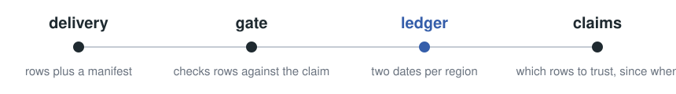

<p align="center">
<picture>
<source media="(prefers-color-scheme: dark)" srcset="docs/assets/wordmark-dark.svg">

</picture>
</p>

<p align="center">
<a href="https://github.com/fpiped/dogana/actions/workflows/ci.yml"></a>
<a href="pyproject.toml"></a>
<a href="LICENSE"></a>
<a href="src/dogana/py.typed"></a>
</p>

# Know which rows you can trust

Most tables are copies of data someone else owns, delivered in pieces: a full export, a rolling
window, the rows changed since yesterday. Pipelines forget what each piece proved the moment it is
loaded. A truncated file quietly empties a table, a deleted row lives on until the next full export,
and nobody can say whether today's numbers are complete.

**dogana remembers.** Each delivery carries a **manifest** that says what it proves. A **gate**
refuses rows that contradict it. A **ledger** keeps two dates for each region of the table:
**complete as of**, nothing is missing, and **valid as of**, nothing deleted is still here. One rule
holds it together: a delivery never raises a date above what it proves.

<p align="center">
<picture>
<source media="(prefers-color-scheme: dark)" srcset="docs/assets/flow-dark.svg">

</picture>
</p>

## In thirty seconds

A full export on October 12, then only the rows changed since:

```python
from datetime import UTC, datetime

from dogana import Contract, Ledger, Shape

day = lambda d: datetime(2026, 10, d, tzinfo=UTC)  # noqa: E731
orders = Contract(
    "orders", key=("id",), types={"id": "int"}, shapes={"full": Shape.full(), "changes": Shape.changes()}
)
ledger = (
    Ledger(orders)
    .apply(orders.manifest("full", day(12)))
    .apply(orders.manifest("changes", day(19), since=day(12)))
)
claims = ledger.claims(day(19))
print(
    f"{claims.state.value}: complete as of {claims.complete_as_of.date()}, "
    f"valid as of {claims.valid_as_of.date()}"
)
```

```text
patched: complete as of 2026-10-19, valid as of 2026-10-12
```

The changes brought every new and updated row, but no deletions: rows deleted at the source after
October 12 may still be here. That sentence, for every table and every region, is what dogana is for.

## The manifest

The sender writes it next to the file, or the receiver derives it from a filename pattern declared
once. It is plain JSON:

```json
{"kind": "Manifest", "version": 1, "table": "orders", "shape": "changes",
 "produced_at": {"$datetime": "2026-10-19T00:00:00+00:00"},
 "since": {"$datetime": "2026-10-12T00:00:00+00:00"}, "window": null, "generation": null,
 "rows": 42, "content_hash": "9f2c41d8", "schema_hash": null, "keys": [], "tombstones": []}
```

The gate checks the rows against it: the count, unique keys, every row inside the window, and a full
export that would shrink the table by more than half. A contradiction is refused whole, and nothing
is written. The same manifest sent twice is a replay, answered with the stored receipt.

## Where it runs

Inside whatever already loads your tables: a cron job, an Airflow task, a dlt pipeline. The core is
pure Python with no dependencies, no server and no scheduler. A store commits the ledger in the same
transaction as the rows; DuckDB is included as the reference, and a conformance suite proves your own.

Not on PyPI yet: `pip install "dogana[duckdb] @ git+https://github.com/fpiped/dogana"`.

If every source reaches you through log-based change data capture with soft deletes, you already
have the answer. dogana is for everything else.

## Learn more

- [Quick start](docs/quickstart.md): a store, a window, a truncated file refused, a replay.
- [Concepts](docs/concepts.md): every term, and what dogana is not.
- [Protocol](docs/protocol.md): every transition, check and obligation.
- [Integrations](docs/integrations.md): dlt, dbt, Iceberg, Spark, orchestrators.
- [Reference implementations](docs/reference.md) and [wire schemas](docs/wire/).

[Apache-2.0](LICENSE).
